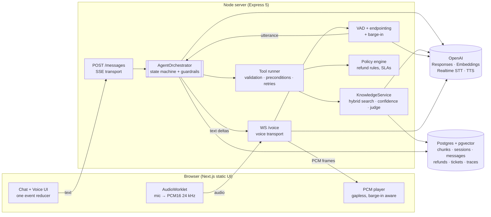

# Acme Cloud Support Agent

A full-stack customer-support AI agent with **streaming chat** and **live voice** over a single agent
orchestrator. It chains tools autonomously (verify identity → read billing → issue refund → escalate),
grounds answers in a pgvector knowledge base, refuses to guess when confidence is low, and shows every
step, prompt, token and cent in an observability drawer.

**Live demo:** `<your Render URL>` · **Walkthrough:** `<Loom link>`

Stack: TypeScript end-to-end. Node 24, Express 5, Drizzle ORM, Postgres + pgvector, Next.js 16 (static
export), Tailwind v4, Zustand, and the Proof8 design system (Radix primitives + CVA, Atkinson Hyperlegible). AI provider: OpenAI (Responses API, `text-embedding-3-small`,
`gpt-live-transcribe`, `gpt-4o-mini-tts`).

---

## Architecture



**Voice is a transport, not a second agent.** Chat and voice both call `AgentOrchestrator.runTurn`, so
tools, guardrails, memory, traces and cost accounting behave identically in both modes. The browser
folds SSE and WebSocket events into the **same reducer**. You can switch between typing and talking
mid-conversation and the agent keeps full context.

| Path | Responsibility |
| --- | --- |
| `packages/contracts` | Typed wire protocol shared by server and UI: domain types, `AgentEvent` union, voice protocol, request DTOs (zod) |
| `apps/server/src/agent` | Orchestrator state machine, prompts, memory window, grounding check, confidence scoring, escalation copy, failure injection |
| `apps/server/src/tools` | Six tools plus the runner (zod-validated args, precondition gate, timeout, retry/backoff, idempotency, structured failures) |
| `apps/server/src/rag` | Structure-aware chunker, incremental ingestion, hybrid retrieval (pgvector + FTS + RRF), confidence, answerability judge |
| `apps/server/src/domain` | Policy engine (refund rules, SLAs: the enforcement source of truth) and the mock CRM |
| `apps/server/src/voice` | VAD, streaming STT client, sentence segmenter, ordered streaming TTS, voice session state machine, WS gateway |
| `apps/server/src/llm` | Provider-neutral `ChatModel`/`Embedder`, OpenAI Responses adapter, resilient streaming, pricing, offline fakes |
| `apps/server/src/db` | Drizzle schema plus generated migrations (applied on boot under an advisory lock) |
| `apps/web` | UI: chat, voice panel + waveform, observability drawer, failure lab |

### The agent loop

```
RECEIVE ─▶ REASON ──tool calls──▶ ACT ──▶ OBSERVE (confidence gate) ──▶ REASON …
              │                                     │ tripped
              └──final text──▶ ESCALATE? ◀──────────┘ (or step limit / policy-mandated)
                                    ▼
                         VERIFY (grounding) ─▶ PERSIST ─▶ DONE
```

The model decides **which** tools to chain; the orchestrator decides **whether the result may stand**.
It is a custom state machine rather than LangGraph, so that every transition is explicit, streamed to
the UI and testable with a scripted model.

| Tool | Notes |
| --- | --- |
| `verify_customer_identity` | Account ID or email + ZIP. Tolerates speech ("A C one zero zero one", "alice at example dot com"). Generic failure message (no account enumeration); locks after 3 failures. |
| `search_knowledge_base` | Tier-scoped retrieval. The tier comes from the **server-side verified session**, never from model arguments. |
| `get_billing_history` | Requires verification (enforced by the runner, not the prompt). |
| `issue_refund` | Policy engine decides `refunded` / `requires_approval` / `denied`. Idempotent per invoice. |
| `update_account_settings` | Allow-listed fields only, validated per field. |
| `create_escalation_ticket` | Queue, priority and SLA routing. A route mandated by the policy engine overrides the model's choice. |

Each conversation is a **sandbox**: refunds, tickets and setting changes are scoped to the session, so
reviewers can rerun every scenario without interfering with each other.

---

## RAG and chunking

**Corpus:** 10 support-policy documents (`knowledge-base/`) with section-level tier tags
(`<!-- tiers: enterprise -->`).

**Chunking: "largest coherent unit that fits".** The chunker parses Markdown into a heading tree and
walks it top-down. If a whole section (with its subsections) fits in 450 tokens and has uniform tier
tags, it becomes one chunk. Only oversized or tier-mixed sections are split: first at child headings,
then at block boundaries (paragraphs, lists and tables are never cut), then at sentences. Each chunk is
embedded with a contextual header (`Refund Policy > Pro Plan Refunds`).

*Why:* in policy text, a rule and its exceptions live in the same section ("full refund within 14
days… above $100 needs approval… after 14 days non-refundable"). Fixed-size windows routinely return the
rule without its conditions, and that is where support bots go wrong. The result is 67 chunks, median
128 tokens, max 284 (cl100k token counts).

**Retrieval:** dense (pgvector cosine, HNSW) ∪ sparse (Postgres full-text, OR-of-terms), fused with
Reciprocal Rank Fusion. Tier scoping runs **in SQL**; unverified sessions only see general policy.
**Dual-query:** both the model's rewritten query and the customer's own words are searched, so a poor
query rewrite can't cause a false "I don't know".

**Ingestion** is idempotent and incremental: unchanged files are skipped, unchanged chunks reuse their
embeddings by content hash, and a model change forces a re-embed. It runs on every boot because the free
tier has no release phase.

## Guardrails against hallucination

| Layer | When | Mechanism |
| --- | --- | --- |
| 1. Similarity gate | every search | Calibrated score = 0.75·sim + 0.15·keyword-agreement + 0.10·doc-margin, plus a hard floor on top-1 cosine (0.30) |
| 2. Answerability judge | medium band only | Structured-output verifier: *do these passages actually answer the question?* Also classifies in/out of domain. Prunes context to the supporting passages. Fails closed. |
| 3. Confidence gate | after each tool step | If retrieval is insufficient, **the model gets no further turn**. The orchestrator routes in-domain questions to a human (ticket plus deterministic copy) and politely declines off-topic ones. |
| 4. Policy engine | refunds | Limits are enforced in code. `requires_approval` mandates escalation; if the model "forgets", the orchestrator opens the ticket itself. |
| 5. Grounding check | every answer | Every amount, %, duration and quantity in the answer must appear in this turn's evidence, and every `[n]` citation must reference a retrieved source. Failures downgrade confidence and flag the message. |

Thresholds are **calibrated, not guessed**: `npm run eval:retrieval -- --judge` runs 30 labelled
questions (answerable, in-domain-but-uncovered, off-topic) through the real pipeline:

| Metric | Result |
| --- | --- |
| Correct document in top-4 | **18 / 18** |
| Answerable questions grounded | **18 / 18** |
| Uncovered + off-topic questions refused | **12 / 12** |
| Top-1 cosine: answerable / uncovered / off-topic | 0.46–0.73 / 0.25–0.50 / 0.08–0.12 |

The one case similarity alone gets wrong ("run Acme on-premise", 0.50) is caught by the judge. That is
the reason layer 2 exists.

---

## Voice pipeline

Cascaded **streaming STT → the same orchestrator → streaming TTS**, chosen over speech-to-speech so
that voice inherits every guardrail and tool policy (a speech-to-speech model can't be stopped before an
ungrounded sentence is already spoken).

- **Capture:** an AudioWorklet resamples the mic to 24 kHz PCM16 in 40 ms frames, with browser echo
  cancellation and noise suppression enabled.
- **VAD (server):** the live transcription models require `turn_detection: null`, so endpointing is
  ours. The VAD is energy-based with an adaptive noise floor and an **echo guard** (higher threshold
  while the agent speaks). Audio is forwarded to STT **only while speech is detected** (plus 300 ms
  pre-roll), which cuts per-minute STT cost and avoids hallucinated transcripts of silence.
- **Live transcript:** `gpt-live-transcribe` streams words while the customer is still talking.
- **Speaking:** text deltas go through a sentence segmenter (the first segment may break at a clause
  for faster first audio), then ordered TTS with one-segment prefetch. Every PCM frame is tagged with its
  response id. While tools run before any answer text, a cached holding phrase ("One moment…") covers
  the silence.
- **Barge-in:** speech onset over the agent **ducks** playback instantly. Sustained speech (320 ms) or
  live-transcribed words confirm the interruption: generation and TTS are aborted, the client flushes
  its queue and reports exactly how many ms it played, and the stored reply is **truncated to what the
  customer actually heard**. The model's memory reflects reality. Backchannels ("mm-hmm", "okay") don't
  interrupt.

Measured locally: end of speech → first audio ≈ **2.9 s** (750 ms endpointing + about 0.3 s transcript
finalisation + model + first TTS byte). Live captions track speech with about 300 ms lag.

---

## Resilience

| Failure | Behaviour |
| --- | --- |
| LLM 429 / 5xx before any output | Retries with full-jitter backoff honouring `Retry-After`, then falls back to a **different model family** (`gpt-4.1-mini`). The UI shows an amber "retrying…" note. |
| LLM stalls | A first-token / idle **watchdog** aborts the stream; the SDK's request timeout can't detect a stalled stream. |
| Failure **after** text was streamed | Never retried (that would duplicate text). Reported with a Retry button; the conversation is saved. |
| Tool error / timeout | Retried with backoff. A persistent failure returns structured `TOOL_UNAVAILABLE` to the model, which apologises and offers a human rather than guessing. |
| Bad tool arguments / wrong order | `INVALID_ARGUMENTS` / `PRECONDITION_FAILED` returned to the model, which self-corrects. |
| Client disconnects mid-turn | The turn is aborted (stops spending tokens) and the partial state is persisted. |
| STT socket drops | Reconnects with backoff; the voice UI shows a non-fatal notice. |

The **Failure lab** tab arms one-shot failures (429, stalled model, transient or persistent tool
outage) for the current session, so all of the above can be shown live.

## Observability

Every turn is traced as OpenTelemetry-shaped spans (turn → llm / tool / retrieval / embedding /
guardrail / stt / tts), streamed live to the drawer and persisted:

- **Overview:** end-to-end latency, time to first token, voice latency, LLM and tool calls, tokens
  (including cached), estimated cost by kind, latency history.
- **Trace:** span waterfall; click any span for its attributes.
- **Prompts:** exact system prompt, message window, response, tool calls and retry attempts for every
  model call.
- **Guardrails:** candidate passages with similarity bars against thresholds, confidence signals, judge
  verdict, gate decision, grounding report.

Costs are estimates from list prices in `llm/pricing.ts` (verified 2026-11-26).

## Production readiness

- **Abuse and cost:** per-IP rate limits (API, chat, session creation), voice concurrency and duration
  caps, per-session turn cap, and a **global daily spend cap** (circuit breaker for a public demo key).
- **Security:** helmet with CSP, WebSocket origin check (cross-site hijacking), tier enforced
  server-side, verification lockout, identity checks before account data, secrets/PII redacted from
  traces, `store: false` at the model provider.
- **Data:** one Postgres for vectors, memory, CRM state and traces, so refunds, messages and traces
  commit in one transaction. Migrations are generated by drizzle-kit.
- **Ops:** typed env validation at boot, JSON logs with request ids, `/healthz` (liveness) and
  `/api/ready` (DB plus knowledge-base ingestion), graceful shutdown, a single Docker image, and CI
  (typecheck, unit + integration tests against pgvector, build, Docker build). CI runs **offline**
  (`AI_PROVIDER=fake`).

---

## Run locally

```bash
cp .env.example .env            # add OPENAI_API_KEY
npm install
npm run dev                     # Postgres on :5433 (Docker) + API on :8080 + UI on :3000
```

Open http://localhost:3000. On first boot the API migrates the database and ingests the knowledge base
(about 10 s). Use **Demo accounts** in the header for test identities. Each card on the start screen
triggers a scenario.

Other commands: `npm test`, `npm run typecheck`, `npm run eval:retrieval -- --judge`,
`npm run ingest -- --force`, `docker compose --profile full up --build` (production image + DB).

## Deploy (free: Render)

1. Push the repo to GitHub.
2. Render → **New → Blueprint** → select the repo. `render.yaml` creates a free Docker web service and a
   free Postgres. Paste `OPENAI_API_KEY` when prompted.
3. Wait for the first deploy. The app migrates and ingests on boot; `/api/ready` turns 200 when done.

Free tier caveats: the service sleeps after about 15 minutes idle (first hit takes 30–60 s), and the
free database expires after 30 days. Swap in a free Neon URL for a longer-lived demo.

## Key trade-offs

- **Cascaded voice instead of speech-to-speech.** Costs about 1–1.5 s more latency, but buys one brain,
  identical guardrails, inspectable text and exact interruption truncation.
- **Custom state machine instead of a framework.** More code, but explicit, observable, fully testable
  transitions and no hidden retries.
- **Deterministic escalation copy when the gate trips.** Less fluent, but it cannot hallucinate and it
  is instant in voice.
- **Energy VAD instead of a neural VAD.** Simple and deterministic, relying on browser echo cancellation
  and noise suppression. Headphones are recommended for the best barge-in; a Silero VAD in the worklet is
  the next step.
- **Single region, single instance, in-memory rate-limit store.** Correct for a demo. For scale: a
  Redis store for limits, sticky sessions or a pub/sub relay for voice, and pgvector iterative scans or
  partial indexes per tier.
- **TTS model lifetime:** `gpt-4o-mini-tts` is scheduled for shutdown on 2027-01-06. TTS sits behind a
  `TextToSpeech` interface, so swapping engines is a one-file change.

## Tests

- **Server:** unit tests for the chunker, confidence, grounding, memory, policy (including a
  knowledge-base ⇄ code consistency check), normalisers, VAD, segmenter, spoken text, resilient
  streaming and the tool runner. An integration suite drives the real orchestrator against pgvector with
  a scripted model: tool chain, confidence gate, forced escalation, preconditions, fallback, abort and
  memory.
- **Web:** event-reducer and SSE-parser tests.
